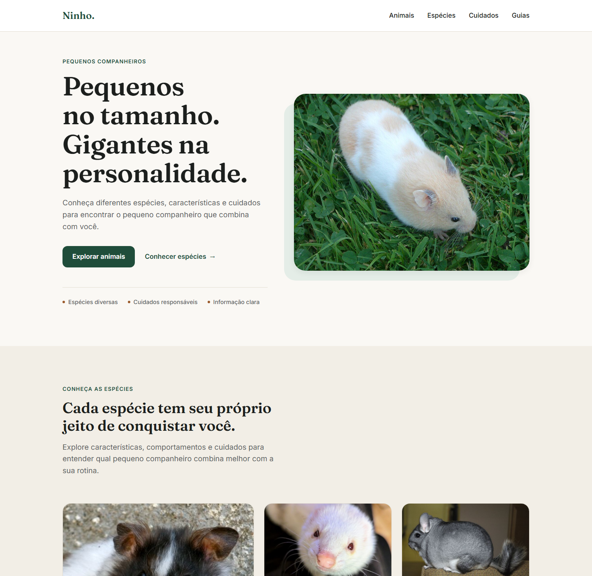
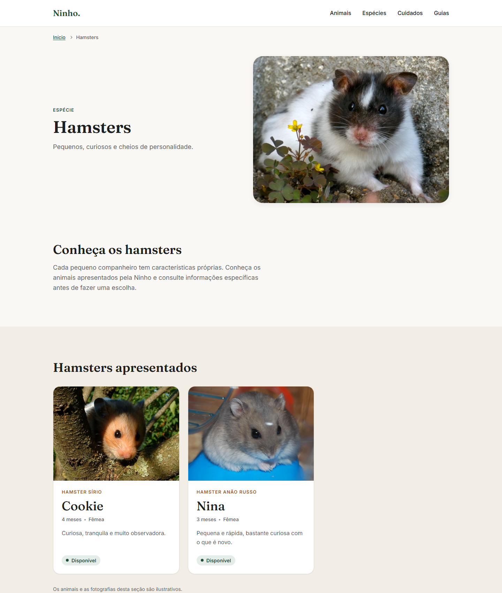
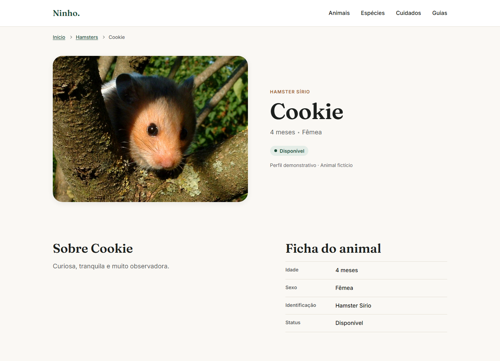

# Ninho

Experiência frontend para descoberta de pequenos animais, espécies e informações sobre cuidado responsável. É um **projeto demonstrativo de frontend**: os animais, as disponibilidades e os textos são ilustrativos, e não existe marketplace, compra, reserva ou contato.



## Sobre o projeto

O Ninho apresenta pequenos companheiros (hamsters, furões, chinchilas, porquinhos-da-índia e gerbils) com fotografia em primeiro plano, muito espaço em branco e uma identidade visual calma, em verde e terracota. A navegação parte da espécie e chega ao animal, e o conteúdo reforça a ideia de escolha responsável.

A versão 1 foi pensada como um projeto pequeno e bem acabado: HTML, CSS e JavaScript sem framework, dados em JSON e um fluxo de navegação completo, em vez de muitas páginas incompletas.

## Fluxo implementado

```
Home → Hamsters → Cookie
Home → Cookie
```

| Página da espécie (`/especies/hamsters/`) | Perfil do animal (`/animais/cookie/`) |
| --- | --- |
|  |  |

Só os cards que têm uma página publicada viram links: **Hamsters**, na seção de espécies da Home, e **Cookie**, na Home e na página de Hamsters. Os demais cards (outras espécies, Oliver, Luna, Nina) são informativos e não mostram indicação de ação. Isso é uma decisão intencional da v1: evita links quebrados, falsas affordances e rotas fictícias.

## Funcionalidades

- Home responsiva com hero, espécies, animais em destaque, orientação de cuidado, guias e rodapé.
- Animais em destaque carregados de `data/animals.json` (registros com `featured: true`).
- Página de espécie (Hamsters) com identidade vinda de `data/species.json` e lista dos animais da espécie.
- Página individual (Cookie) com fotografia, ficha do animal e bloco "Sobre a espécie".
- Cards navegáveis somente quando existe destino real, com hover, foco e toque tratados.
- Navbar responsiva com menu mobile, skip link e breadcrumbs nas páginas internas.
- Estados de carregamento e de erro, e aviso quando o JavaScript está desativado.
- Imagens responsivas (`srcset`), com espaço reservado quando uma fotografia não carrega nas páginas internas.
- Animais com ou sem fotografia, e dados inválidos tratados sem quebrar a página.
- Suporte a `prefers-reduced-motion` e a navegação completa por teclado.

## Tecnologias

- HTML5
- CSS3 (variáveis CSS, Grid e Flexbox)
- JavaScript Vanilla com ES Modules
- JSON para os dados
- Google Fonts (Fraunces e Inter)

Sem framework, bundler, gerenciador de pacotes ou dependências a instalar.

## Como executar

O projeto precisa ser servido por HTTP. Não abra o `index.html` diretamente (`file://`): o navegador bloqueia o `fetch` dos arquivos JSON e o carregamento dos ES Modules, e as seções dinâmicas não funcionam.

Na raiz do projeto, com Python instalado:

```bash
python -m http.server 8000
```

Em alguns ambientes (macOS e Linux) o comando é `python3 -m http.server 8000`.

Depois abra [http://localhost:8000](http://localhost:8000). As páginas internas ficam em `/especies/hamsters/` e `/animais/cookie/`. Qualquer outro servidor estático serve. Todos os caminhos do projeto são relativos, sem dependência de ficar na raiz do domínio.

## Estrutura do projeto

```
index.html                 Home
especies/hamsters/         página da espécie
animais/cookie/            página individual do animal
assets/                    favicon e fotografias (animals/, species/, guides/)
css/
  variables.css            tokens do Design System
  reset.css, base.css      reset e estilos de base
  components/              componentes compartilhados (navbar, cards, rodapé...)
  pages/                   estilos específicos das páginas internas
data/                      animals.json e species.json (dados demonstrativos)
js/                        navbar.js, módulos de cada página e animal-utils.js
docs/                      design-system.md e screenshots
```

- `data/` guarda os contratos de dados, todos fictícios.
- `css/components/` reúne o que é compartilhado entre páginas, e `css/pages/` o que é específico de cada uma.
- `js/animal-utils.js` concentra utilidades compartilhadas de apresentação (idade, sexo, status, caminho de imagem e a lista de páginas publicadas).
- Cada página interna tem o próprio diretório e o próprio módulo em `js/`.

O Design System, com tokens, tipografia, espaçamentos, cards e estados de interação, está documentado em [docs/design-system.md](docs/design-system.md).

## Decisões do projeto

**Sem framework.** HTML, CSS e JavaScript Vanilla foram usados de propósito, para mostrar os fundamentos do frontend.

**Dados separados da apresentação.** Animais e espécies ficam em JSON. `animals.json` relaciona cada animal à espécie por `species`, igual ao `id` em `species.json`; o campo `breed` é só um rótulo de exibição. A seção de espécies da Home é HTML estático, e `species.json` alimenta as páginas internas.

**Navegação somente para destinos publicados.** Ter `slug` no JSON não significa ter página. A função `getAnimalPagePath` (em `js/animal-utils.js`) é o único lugar que liga o slug de um animal à página publicada, e só Cookie consta nela.

**Imagem opcional.** O contrato aceita animal com ou sem fotografia: sem `image`, o card mostra apenas o conteúdo e a página individual esconde o bloco da foto.

**Responsividade mobile-first.** O CSS base é o mobile, e os breakpoints reais são 768px e 1024px.

**Design System.** Cores, tipografia, espaçamentos e estados vêm de tokens em `css/variables.css`, descritos em `docs/design-system.md`.

## Acessibilidade

O projeto incorpora práticas de acessibilidade alinhadas ao WCAG AA, sem pretender ser uma conformidade certificada:

- skip link como primeiro foco, apontando para o `<main>`;
- navegação completa por teclado e `:focus-visible` consistente (3px, cor primária);
- menu mobile com `aria-expanded`, `aria-controls` e rótulo que alterna entre "Abrir menu" e "Fechar menu", fechado também com Escape;
- um único link por card navegável, e cards sem destino fora da ordem de Tab;
- texto alternativo nas fotografias e status indicado por texto, não só por cor;
- alvos de toque de pelo menos 44px e pares de cores principais com contraste mínimo de 4,5:1;
- `prefers-reduced-motion` respeitado e estados dinâmicos anunciados com `role="status"`.

## Responsividade

As páginas foram verificadas entre cerca de 360px e 1440px, sem rolagem horizontal. No mobile o layout é de uma coluna, com menu recolhido; a partir de 768px a Navbar fica horizontal e vários blocos passam a duas colunas; a partir de 1024px entram os grids de três colunas e o mosaico de espécies. O container para em 1200px.

As verificações foram feitas em navegador baseado em Chromium (Edge). Firefox e Safari não foram testados.

## Dados demonstrativos

Os animais são fictícios. Nomes, idades, disponibilidade e descrições são ilustrativos e não representam anúncios comerciais reais. O projeto não tem compra, reserva nem contato. O caráter demonstrativo aparece na Home e na página de Hamsters, no perfil do Cookie e no rodapé de todas as páginas.

## Escopo da versão

A v1 demonstra, deliberadamente, uma página de espécie, uma página individual e o fluxo completo de navegação entre elas e a Home. As outras espécies e os outros animais aparecem como conteúdo demonstrativo, mas não têm páginas individuais nesta versão.

## Créditos das imagens

Todas as fotografias vêm do Wikimedia Commons, em domínio público ou CC0, e foram apenas recortadas (4:3) e redimensionadas. Essas licenças não exigem atribuição; os créditos abaixo são dados por transparência. As informações foram conferidas nas páginas originais.

| Uso | Obra | Autor | Licença | Fonte |
| --- | --- | --- | --- | --- |
| Hero da Home | "Hamster im Gras" | Tux | Domínio público ([PD-self](https://commons.wikimedia.org/wiki/Template:PD-self)); o autor também a oferece em [CC BY-SA 3.0](https://creativecommons.org/licenses/by-sa/3.0/) e CC BY-SA 2.0 DE | [Commons](https://commons.wikimedia.org/wiki/File:Hamster_im_Gras.jpg) |
| Espécie Hamsters | "Hamster in the yard" | Lo | [CC0 1.0](https://creativecommons.org/publicdomain/zero/1.0/) | [Commons](https://commons.wikimedia.org/wiki/File:Hamster_in_the_yard.jpg) |
| Espécie Furões | "White Ferret with pink snout" | Electo84 | CC0 1.0 | [Commons](https://commons.wikimedia.org/wiki/File:White_Ferret_with_pink_snout.jpg) |
| Espécie Chinchilas | "Chinchilla lanigera1" | Trurl66 | Domínio público ([PD-user](https://commons.wikimedia.org/wiki/Template:PD-user)) | [Commons](https://commons.wikimedia.org/wiki/File:Chinchilla_lanigera1.jpg) |
| Espécie Porquinhos-da-índia | "Guinea pig with a tonsure" | ArtemisiaGentileschiFan | CC0 1.0 | [Commons](https://commons.wikimedia.org/wiki/File:Guinea_pig_with_a_tonsure.jpg) |
| Espécie Gerbils | "Meriones unguiculatus-front" | Pacos (Wikipédia polonesa) | Domínio público (PD-user) | [Commons](https://commons.wikimedia.org/wiki/File:Meriones_unguiculatus-front.jpg) |
| Animal Cookie | "Hamster In A Tree" | Uwe Jelting | CC0 1.0 | [Commons](https://commons.wikimedia.org/wiki/File:Hamster_In_A_Tree_%28184178955%29.jpeg) |
| Animal Oliver | "FerretAfterShower" | Jeff Weiss | Domínio público (PD-self) | [Commons](https://commons.wikimedia.org/wiki/File:FerretAfterShower.jpg) |
| Animal Luna | "RunningChin" | Trurl66 (Wikipédia em inglês) | Domínio público (PD-user) | [Commons](https://commons.wikimedia.org/wiki/File:RunningChin.jpg) |
| Animal Nina | "DjungarianHamster Diesel" | Adamderesz | Domínio público (PD-self) | [Commons](https://commons.wikimedia.org/wiki/File:DjungarianHamster_Diesel.jpg) |
| Guia Cuidados | "Finished hamster habitat project" | Lo | CC0 1.0 | [Commons](https://commons.wikimedia.org/wiki/File:Finished_hamster_habitat_project.jpg) |
| Guia Alimentação | "A Guinea pig and its carrot" | Kuli | CC0 1.0 | [Commons](https://commons.wikimedia.org/wiki/File:A_Guinea_pig_and_its_carrot.jpg) |
| Guia Bem-estar | "Gerbil ready to start eating" | Maniago | Domínio público (PD-self) | [Commons](https://commons.wikimedia.org/wiki/File:Gerbil_ready_to_start_eating.JPG) |

A fotografia do Cookie foi enviada ao Commons por uma ferramenta de importação a partir de uma versão arquivada do 500px (Archive Team). A página do Commons e o registro arquivado do 500px indicam CC0, mas a página do Commons não tem revisão de licença feita por uma pessoa.
